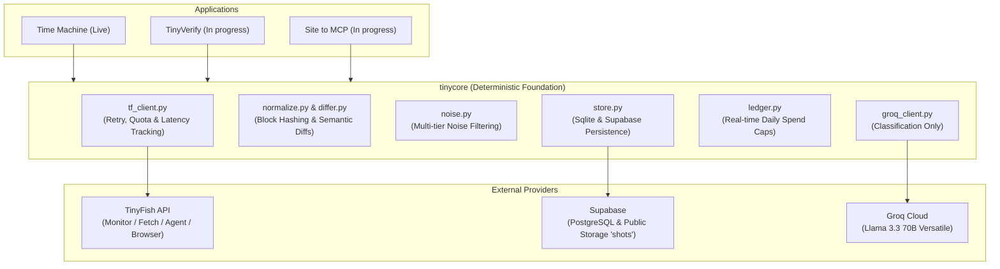

# TinyFish Bounties

> Three autonomous web-intelligence services built on TinyFish's Web Agent & Browser API.

[](tests/)
[](samples/timemachine/tracked_pages.json)
[](LICENSE)
[](pyproject.toml)
[](docs/ARCHITECTURE.md)

---

## 🚀 Status Table

| Application | Status | TinyFish Endpoints Used | Live Evidence / Endpoints | Primary Tech Stack |
| :--- | :--- | :--- | :--- | :--- |
| **[Time Machine](apps/timemachine/)** | 🟢 **Live & Monitoring** (28 pages) | `Monitor` (cron schedule), `Fetch` (fast baselines), `Browser CDP` (screenshots) | [`/as-of`](apps/timemachine/README.md#api-reference), [`/changes`](apps/timemachine/README.md#api-reference), [`/export.json`](samples/timemachine/tracked_pages.json) | FastAPI, Supabase Postgres & Storage, Groq Llama-3 |
| **[TinyVerify](apps/tinyverify/)** | 🚧 **In progress** (Architecture phase) | `Agent` (search forms), `Fetch` (registries) | Spec in [`docs/specs/01_TinyVerify_SPEC.md`](docs/specs/01_TinyVerify_SPEC.md) | Python, Pydantic, Groq |
| **[Site to MCP](apps/site2mcp/)** | 🚧 **In progress** (Architecture phase) | `Agent` (DOM traversal), `Fetch` (API docs) | Spec in [`docs/specs/03_SiteToMCP_SPEC.md`](docs/specs/03_SiteToMCP_SPEC.md) | FastMCP, Python, Groq |

---

## 💡 The Story: Why These Three?

Every autonomous system operating on the open web faces three persistent hurdles:
1. **Temporal Blindness**: When did that pricing page change? What was the exact refund policy on October 1st?
2. **Epistemic Fragility**: Is this corporate registry claim corroborated across independent primary sources?
3. **Interface Brittleness**: How can an agent reliably interact with custom web surfaces without writing manual scrapers for each tool?

This repository solves all three using a unified substrate (**`tinycore`**):
- **Time Machine** continuously monitors web surfaces, eliminates dynamic noise, computes semantic diffs, captures visual evidence, and enables point-in-time state reconstruction.
- **TinyVerify** cross-references claims across live regulatory registries and public filings using autonomous agent traversal.
- **Site to MCP** autonomously analyzes web surfaces and documentation to synthesize compliant Model Context Protocol (MCP) tool servers.

---

## 🏛️ System Architecture



---

## 📐 Core Engineering Principles

1. **Python Owns Deterministic Logic**:
   - Parsing, block hashing, differential computation, and rate limiting are handled by pure, deterministic Python code.
   - LLMs are never entrusted with arithmetic, dates, token hashing, or diff calculations.
2. **Strict LLM Boundary**:
   - Groq is utilized solely for semantic categorization (e.g., classifying a diff as `pricing_increase` vs. `routine_update`) and structured entity extraction.
   - All model outputs are strictly validated against Pydantic schemas with deterministic fallbacks.
3. **Hard Cost & Quota Ceilings**:
   - Real-time `CostLedger` enforces strict per-day spending bounds.
   - Global monitor count is hard-capped ($\le 50$) and tracked across all applications.
4. **Verifiable Visual Proof**:
   - Every substantive change is backed by timestamped screenshots archived to Supabase Storage.
5. **Zero Secret Leakage**:
   - Zero credentials in code or version control; continuous secret scanning via `.gitleaks.toml`.

---

## ⚡ Quick Start (Local Development)

Get the offline test suite and Time Machine API running locally in 5 commands:

```bash
# 1. Clone repository
git clone https://github.com/pritpatel2412/tinyfish-bounties.git
cd tinyfish-bounties

# 2. Set up virtual environment
python -m venv .venv
source .venv/bin/activate  # On Windows: .\.venv\Scripts\Activate.ps1

# 3. Install pinned dependencies
pip install -r requirements.txt

# 4. Run offline test suite (100% green, no API keys needed)
pytest -m "not live"

# 5. Start Time Machine API locally
uvicorn apps.timemachine.api:app --host 127.0.0.1 --port 8000
```

Verify your local server:
```bash
curl http://127.0.0.1:8000/health
# Returns: {"status":"healthy","uptime_s":...,"processor_heartbeat_age_s":...,"version":"1.0.0","timestamp":"..."}
```

---

## 📂 Repository Map

```
tinyfish-bounties/
├── README.md                 # Project root overview & status
├── LICENSE                   # MIT License (Prit Patel)
├── pyproject.toml            # Project metadata & tool configuration
├── requirements.txt          # Pinned dependencies
├── render.yaml               # Production deployment blueprint
├── Dockerfile                # Production container spec
├── .gitleaks.toml            # Automated secret scanner configuration
├── .env.example              # Environment variable template
│
├── tinycore/                 # Shared deterministic foundation
│   ├── README.md             # Substrate documentation & architecture
│   ├── tf_client.py          # Unified TinyFish API client (retries, logging, cost)
│   ├── groq_client.py        # Schema-validated Groq LLM client
│   ├── store.py              # Sqlite & Supabase persistence backends
│   ├── normalize.py          # HTML/Markdown semantic block normalizer
│   ├── differ.py             # Deterministic block differ & numeric deltas
│   ├── noise.py              # Multi-tier noise filter (timestamps, banners)
│   ├── ledger.py             # Cost accounting & monitor budget tracker
│   └── api_common.py         # FastAPI factory, error envelopes & health telemetry
│
├── apps/
│   ├── timemachine/          # 🟢 Time Machine MVP (Live)
│   │   ├── README.md         # Flagship product documentation
│   │   ├── api.py            # Public REST API (/as-of, /changes, /export.json)
│   │   ├── processor.py      # Background ingestion & diff processing worker
│   │   ├── watchdog.py       # Hourly telemetry & wallet monitoring daemon
│   │   ├── capture.py        # Snapshot capture orchestrator
│   │   └── seed.py           # Vetted page catalogue seeder
│   ├── tinyverify/           # 🚧 TinyVerify (In progress)
│   │   └── README.md         # Problem statement, architecture & spec link
│   └── site2mcp/             # 🚧 Site to MCP (In progress)
│       └── README.md         # Problem statement, architecture & spec link
│
├── docs/                     # Comprehensive documentation
│   ├── ARCHITECTURE.md       # Monorepo system architecture & failure modes
│   ├── TINYFISH_USAGE.md     # TinyFish endpoint analysis, latencies & costs
│   ├── API_TIMEMACHINE.md    # Complete OpenAPI & curl documentation
│   ├── OPERATIONS.md         # Production runbooks, deploy guide & alerts
│   ├── DECISIONS.md          # Immutable architecture decision record
│   ├── tinyfish-notes.md     # Live endpoint probe findings & notes
│   └── specs/                # Product specification documents
│
├── infra/                    # Cloud infrastructure
│   └── supabase/
│       ├── timemachine.sql   # Postgres schema, indexes & storage policies
│       └── edge_function_tf_webhook.ts # Supabase Edge Function webhook router
│
├── samples/                  # Verifiable judge-facing samples
│   └── timemachine/
│       ├── tracked_pages.json # Live export of 28 monitored surfaces
│       ├── changes.json       # Real-world change event stream
│       └── verification/      # Controlled test pipeline proof (test-only)
│
├── scripts/                  # Operational & administrative tooling
│   ├── audit_monitors.py     # Live TinyFish monitor sync & cleanup
│   ├── verify_scheduled_flow.py # Monitor schedule & cadence auditor
│   ├── migrate_sqlite_to_supabase.py # Production database migrator
│   └── scan_secrets.py       # Pre-commit secret scanning script
│
└── tests/                    # 100% offline passing test harness
    ├── conftest.py           # Global fixtures & test isolation
    ├── unit/                 # Unit tests (normalize, differ, ledger, store)
    ├── integration/          # Integration tests (api, processor, capture, watchdog)
    └── fixtures/             # Static webhook & HTML fixtures
```

---

## 🔒 Security & Compliance

- **Responsible Disclosure**: See [`SECURITY.md`](SECURITY.md).
- **Contributing Guidelines**: See [`CONTRIBUTING.md`](CONTRIBUTING.md).
- **Code of Conduct**: See [`CODE_OF_CONDUCT.md`](CODE_OF_CONDUCT.md).
- **Changelog**: See [`CHANGELOG.md`](CHANGELOG.md).
