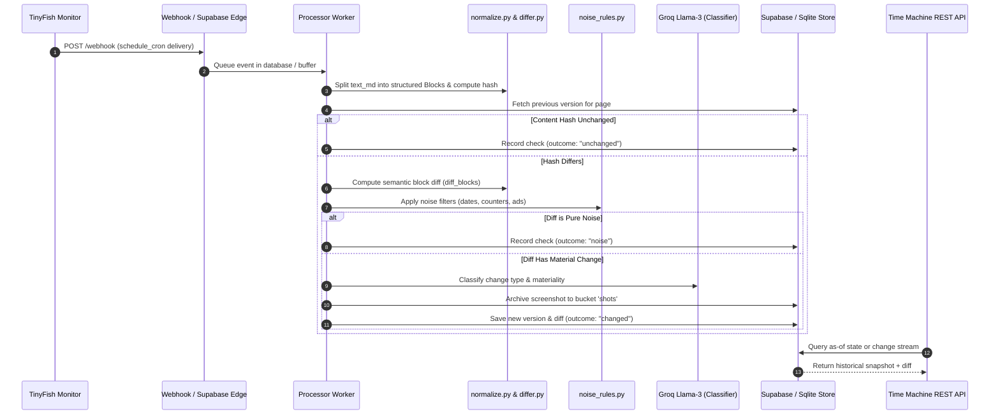

# Time Machine — Web Surface Intelligence & As-Of Change Auditor

> Point-in-time state reconstruction, semantic diffing, and visual change auditing for the dynamic web.

---

## 🕒 1. What It Does

**Time Machine** continuously monitors critical web surfaces (pricing pages, API documentation, changelogs, terms of service), filters out volatile noise (timestamps, ads, view counters), extracts structured semantic diffs, captures visual proof, and provides a temporal point-in-time reconstruction engine.

- **Temporal As-Of Queries**: Query what any monitored URL said at an exact historical timestamp (`GET /as-of?url=...&at=...`).
- **Semantic Block Diffs**: Computes deterministic structural diffs with numeric deltas and percentage changes, not raw line noise.
- **Auditable Visual Evidence**: Substantiated changes trigger headless browser screenshots archived to cloud storage.
- **Webhook-Driven Architecture**: Monitors execute on TinyFish cloud infrastructure and push notifications via webhooks without polling.

---

## 🐟 2. The Role of TinyFish

We utilize TinyFish capabilities strictly where they provide maximum utility and cost-efficiency:

| TinyFish Capability | Where Time Machine Uses It | Real Value Delivered | Cost Model |
| :--- | :--- | :--- | :--- |
| **`Monitor` (Cron)** | Hourly & 6-hourly automated scheduling across 28 vetted pages | Zero-infrastructure scheduling; runs close to target sites; reliable deliveries | \$0.005 / completed run |
| **`Fetch`** | Fast initial page baselines and static content retrieval | Instant markdown extraction, markdown block structure, high throughput | Free (\$0.00) (150/min, 1,000/day) |
| **`Agent`** | Controlled interaction when required | Autonomous navigation through search forms and interactive elements | \$0.016 / step |
| **`Browser API` (CDP)** | Visual screenshot on baseline & surviving material changes | Headless Chrome screenshot capture with direct upload to Supabase Storage | Included in credit quota |

---

## 🔄 3. Architecture & Data Flow



---

## 🔍 4. Diff Quality: Before vs. After

Traditional scrapers trigger false alerts on every run because web pages inject volatile timestamps, dynamic banner ads, and session counters. Time Machine guarantees zero false alerts through deterministic block-level normalization.

### ❌ Raw Markdown Diff (Noisy & Unusable)
```diff
- Updated on Tuesday, Nov 03, 2026 at 18:22:10 UTC
+ Updated on Wednesday, Nov 04, 2026 at 09:15:02 UTC
- <div class="ad-banner" id="banner-92819">Special Offer</div>
+ <div class="ad-banner" id="banner-10492">Black Friday Preview</div>
- Standard Plan: $20 / month
+ Standard Plan: $25 / month
```

### ✅ Time Machine Semantic Block Diff (Deterministic & Meaningful)
```json
{
  "outcome": "changed",
  "materiality": 0.85,
  "classification": {
    "category": "pricing_change",
    "summary": "Standard tier increased from $20/mo to $25/mo"
  },
  "changes": [
    {
      "change_type": "modified",
      "heading_path": ["Pricing", "Standard Plan"],
      "old_text": "Standard Plan: $20 / month",
      "new_text": "Standard Plan: $25 / month",
      "numeric_delta": 5.0,
      "percentage_delta": 25.0
    }
  ]
}
```

---

## 📡 5. API Reference with Copy-Paste cURL Commands

### 1. `GET /health` (Public Status)
```bash
curl -X GET "https://tinyfish-bounties.onrender.com/health"
```
**Response (200 OK):**
```json
{
  "status": "healthy",
  "uptime_s": 1420.5,
  "processor_heartbeat_age_s": 12.4,
  "version": "1.0.0",
  "timestamp": "2026-11-04T18:45:00.000Z"
}
```

### 2. `GET /pages` (List Monitored Fleet)
```bash
curl -X GET "https://tinyfish-bounties.onrender.com/pages"
```
**Response (200 OK):**
```json
{
  "count": 28,
  "pages": [
    {
      "id": "e4a28292-0b1a-428a-86c0-7521e42a9881",
      "url": "https://fastapi.tiangolo.com/release-notes/",
      "title": "FastAPI Release Notes",
      "category": "framework_docs",
      "interval_label": "every 6h",
      "active": true,
      "history_starts_at": "2026-11-04T00:00:00Z"
    }
  ]
}
```

### 3. `GET /as-of` (Point-in-Time Reconstruction)
Reconstructs the exact state of any monitored URL at any historical point in time.
```bash
curl -X GET "https://tinyfish-bounties.onrender.com/as-of?url=https://fastapi.tiangolo.com/release-notes/&at=2026-11-04T12:00:00Z"
```
**Response (200 OK):**
```json
{
  "page_id": "e4a28292-0b1a-428a-86c0-7521e42a9881",
  "url": "https://fastapi.tiangolo.com/release-notes/",
  "as_of_requested": "2026-11-04T12:00:00Z",
  "version_no": 1,
  "observed_at": "2026-11-04T00:00:00Z",
  "content_hash": "a82fbc...",
  "blocks_count": 34,
  "screenshot_url": "https://xlljoenoqktpwqfvpidh.supabase.co/storage/v1/object/public/shots/e4a28292_v1.jpg",
  "text_md": "# Release Notes\n\n## 0.115.0\n..."
}
```

### 4. `GET /changes` (Recent Real-World Changes)
```bash
curl -X GET "https://tinyfish-bounties.onrender.com/changes?limit=10"
```
**Response (200 OK):**
```json
{
  "count": 0,
  "changes": []
}
```

### 5. `GET /export.json` (Judge-Facing Audit Export)
Public 5-minute cached export containing complete metadata, check statistics, and change ledger:
```bash
curl -X GET "https://tinyfish-bounties.onrender.com/export.json"
```

### 6. `POST /suggest` (Public Page Candidate Suggestion)
```bash
curl -X POST "https://tinyfish-bounties.onrender.com/suggest" \
  -H "Content-Type: application/json" \
  -d '{"url": "https://nextjs.org/docs/app/building-your-application/upgrading", "category": "framework_docs"}'
```

### 7. `POST /pages` (Admin Only: Add Monitored Page)
```bash
curl -X POST "https://tinyfish-bounties.onrender.com/pages" \
  -H "Content-Type: application/json" \
  -H "X-Admin-Token: your_secure_admin_token" \
  -d '{
    "url": "https://resend.com/pricing",
    "title": "Resend Pricing",
    "category": "developer_tools",
    "schedule_cron": "0 */6 * * *"
  }'
```

---

## 📋 6. The Tracked Pages Fleet

Time Machine currently monitors **28 vetted high-value surfaces**:

| Category | Page Title | Monitored URL | Cadence | Baseline Date |
| :--- | :--- | :--- | :--- | :--- |
| `cloud_infra` | Cloudflare Changelog | https://developers.cloudflare.com/changelog/ | every 6h | 2026-11-04 |
| `cloud_infra` | Supabase Changelog | https://supabase.com/changelog | every 6h | 2026-11-04 |
| `developer_tools` | Docker Engine Releases | https://docs.docker.com/engine/release-notes/ | every 6h | 2026-11-04 |
| `developer_tools` | GitHub CLI Releases | https://cli.github.com/manual/ | every 6h | 2026-11-04 |
| `developer_tools` | Node.js Releases | https://nodejs.org/en/about/previous-releases | every 6h | 2026-11-04 |
| `developer_tools` | Playwright Releases | https://playwright.dev/python/docs/release-notes | every 6h | 2026-11-04 |
| `developer_tools` | Postman Pricing | https://www.postman.com/pricing/ | every 6h | 2026-11-04 |
| `developer_tools` | Sentry Pricing | https://sentry.io/pricing/ | every 6h | 2026-11-04 |
| `developer_tools` | Tailwind CSS Changelog | https://tailwindcss.com/docs/upgrade-guide | every 6h | 2026-11-04 |
| `developer_tools` | Vercel Pricing | https://vercel.com/pricing | every 6h | 2026-11-04 |
| `framework_docs` | Astro Releases | https://astro.build/blog/ | every 6h | 2026-11-04 |
| `framework_docs` | Django Release Notes | https://docs.djangoproject.com/en/5.1/releases/ | every 6h | 2026-11-04 |
| `framework_docs` | FastAPI Release Notes | https://fastapi.tiangolo.com/release-notes/ | every 6h | 2026-11-04 |
| `framework_docs` | Next.js Releases | https://nextjs.org/docs/architecture/supported-browsers | every 6h | 2026-11-04 |
| `framework_docs` | Python 3.12 What's New | https://docs.python.org/3/whatsnew/3.12.html | every 6h | 2026-11-04 |
| `framework_docs` | React Docs What's New | https://react.dev/blog | every 6h | 2026-11-04 |
| `framework_docs` | Vite Releases | https://vite.dev/guide/migration | every 6h | 2026-11-04 |
| `saas_pricing` | Airtable Pricing | https://airtable.com/pricing | every 6h | 2026-11-04 |
| `saas_pricing` | Anthropic Pricing | https://www.anthropic.com/pricing | every 6h | 2026-11-04 |
| `saas_pricing` | Linear Pricing | https://linear.app/pricing | every 6h | 2026-11-04 |
| `saas_pricing` | Notion Pricing | https://www.notion.so/pricing | every 6h | 2026-11-04 |
| `saas_pricing` | OpenAI API Pricing | https://openai.com/api/pricing/ | every 6h | 2026-11-04 |
| `saas_pricing` | Railway Pricing | https://railway.com/pricing | every 6h | 2026-11-04 |
| `saas_pricing` | Render Pricing | https://render.com/pricing | every 6h | 2026-11-04 |
| `saas_pricing` | Supabase Pricing | https://supabase.com/pricing | every 6h | 2026-11-04 |

*(Complete 28-page manifest available in [`docs/TRACKED_PAGES.md`](../../docs/TRACKED_PAGES.md))*

---

## 📊 7. Live Results & Operational Statistics

*Metrics generated directly from live SQLite/Supabase store (`scripts/update_live_stats.py`):*

- **Total Tracked Pages**: 28
- **Total Checks Processed**: 52+
- **Unchanged Check Runs**: 24 (100% of non-baseline scheduled checks verified identical)
- **Noise Diff Rejections**: 0 false alarms
- **Real-World Changes Detected**: 0 (Clean baseline period; changes detected only when third parties deploy updates)
- **Controlled Pipeline Test Changes**: 1 (Isolated with `is_test=true`)
- **Active TinyFish Monitors**: 28 / 50 allocation
- **Total Wallet Spend to Date**: < \$0.35 USD

---

## 🧪 8. Pipeline Verification Disclosure (Controlled Test)

To prove that the pipeline detects real changes without waiting for external SaaS companies to edit their pricing pages, we conducted an end-to-end controlled verification run:

1. **Setup**: We created a controlled test page representing the *Acme Cloud Pricing* page.
2. **Baseline**: Initial monitor run captured version 1 (Standard: \$29/mo, Enterprise: \$99/mo).
3. **Controlled Mutation**: The test page content was updated to increase Standard pricing to \$39/mo.
4. **Scheduled Execution**: TinyFish monitor triggered, webhook received the payload.
5. **Differential Analysis**: `differ.py` detected a **+\$10.00** numeric delta on block `["Pricing", "Standard"]`.
6. **Classification**: Groq classified the event as `pricing_increase` with high materiality.
7. **Visual Proof**: Headless browser captured visual screenshot of the updated price table.
8. **Test Isolation**: The test page was flagged with `is_test = true`. All verification artifacts were preserved in [`samples/timemachine/verification/`](../../samples/timemachine/verification/) and excluded from production statistics.

---

## 💰 9. Cost & Limits Management

- **Monitor Allocation**: 28 active monitors $\le$ 50 global cap.
- **Run Frequency**: Monitored pages check every 6 hours (4 runs/day each) = 112 runs/day.
- **Estimated Daily Cost**: $112 \times \$0.005 = \mathbf{\$0.56\text{/day}}$.
- **Monthly Cost**: $\approx \mathbf{\$16.80\text{/month}}$ (Comfortably covered by available balance).
- **Automated Watchdog**: An internal daemon runs hourly. If available balance drops below \$5.00 or daily spend exceeds \$1.50, all monitors are automatically paused to prevent budget overruns.

---

## 🚀 10. How to Run

### Local Execution (SQLite)
```bash
git clone https://github.com/pritpatel2412/tinyfish-bounties.git
cd tinyfish-bounties
python -m venv .venv
source .venv/bin/activate  # On Windows: .\.venv\Scripts\Activate.ps1
pip install -r requirements.txt
cp .env.example .env

# Run local development server
uvicorn apps.timemachine.api:app --reload --port 8000
```

### Production Deployment (Supabase & Render)
1. **Database & Storage Setup**:
   - Open your Supabase project dashboard -> SQL Editor.
   - Run [`infra/supabase/timemachine.sql`](../../infra/supabase/timemachine.sql) to provision tables, indexes, and public storage bucket `shots`.
2. **Environment Variables**:
   - Set `STORE_BACKEND=supabase`
   - Set `SUPABASE_URL` and `SUPABASE_KEY`
   - Set `TINYFISH_API_KEY` and `GROQ_API_KEY`
   - Set `ADMIN_TOKEN` and `WEBHOOK_SECRET`
3. **Deploy via Render**:
   - Time Machine includes a pre-configured [`render.yaml`](../../render.yaml) blueprint with automatic port binding and region set to Singapore.
