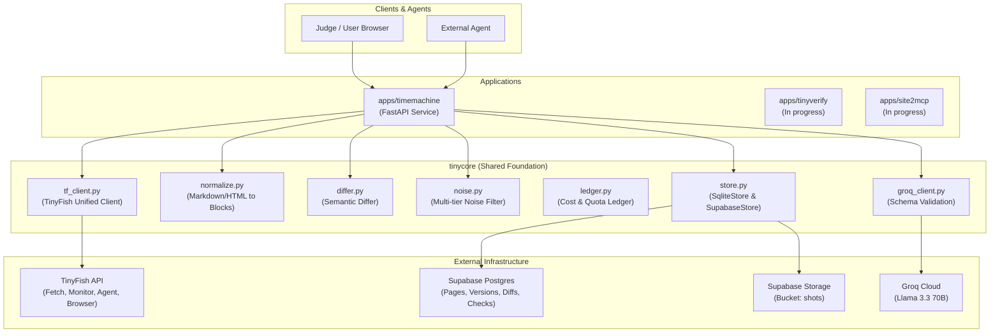
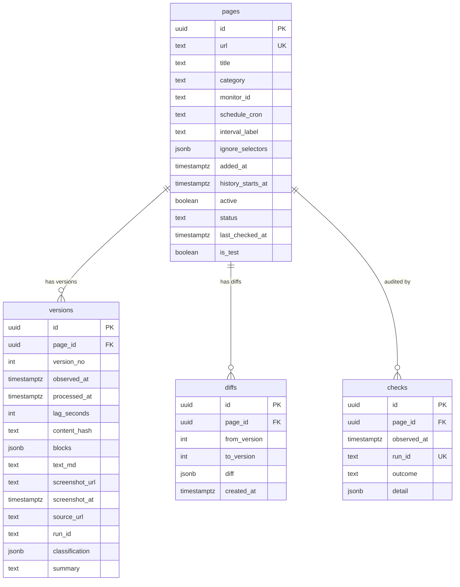

# System Architecture

This document details the architectural foundation, data models, component interactions, and resilience mechanisms across all three applications in the TinyFish Bounties monorepo.

---

## 1. System Topology

The system is organized into a clean 3-tier architecture:
1. **User / Agent Layer**: REST APIs, temporal queries (`/as-of`), change streams, judge-facing exports.
2. **Deterministic Processing Core (`tinycore`)**: Pure Python normalizers, semantic differs, noise filters, cost accounting, and storage adapters.
3. **External Services**: TinyFish Cloud (scraping, monitoring, agent steps, browser CDP), Groq (LLM classification), and Supabase (Postgres & Storage).

---

## 2. Component Responsibilities

| Component | Module | Responsibility |
| :--- | :--- | :--- |
| **`tf_client`** | `tinycore/tf_client.py` | Unified gateway to all TinyFish endpoints. Enforces rate limiting, exponential backoff retries on 429/5xx, transparency logging in `data/tf_calls.jsonl`, and credit calculation. |
| **`normalize`** | `tinycore/normalize.py` | Converts unstructured Markdown/HTML into ordered semantic `Block` entities (`heading`, `paragraph`, `table_row`, `list_item`). Attaches hierarchical `heading_path` breadcrumbs, extracts numeric tokens, and generates stable SHA-256 block hashes. |
| **`differ`** | `tinycore/differ.py` | Compares block arrays between versions. Identifies modified blocks, computes numeric deltas, percentage shifts, and keyword insertions. |
| **`noise`** | `tinycore/noise.py` | Deterministically strips volatile noise: dynamic timestamps, relative dates ("updated 2h ago"), view counters, session IDs, and rotating banner ads. |
| **`ledger`** | `tinycore/ledger.py` | Tracks expenditure against a strict hard daily ceiling (max \$1.50/day) and prevents exceeding the global 50-monitor allocation. |
| **`groq_client`** | `tinycore/groq_client.py` | Invokes Groq Llama-3 models solely for semantic classification and entity extraction. Outputs are strictly schema-validated via Pydantic with fallback to deterministic rules. |
| **`store`** | `tinycore/store.py` | Common storage interface supporting `SqliteStore` for local development and `SupabaseStore` for cloud deployment, alongside `ScreenshotStore` for visual evidence archival. |
| **`api_common`** | `tinycore/api_common.py` | Standardized FastAPI application factory providing uniform error envelopes, CORS headers, public `/health`, and protected `/admin/health`. |

---

## 3. Data Model (Entity Relationship Diagram)

---

## 4. Why Supabase Persistence?

Free-tier hosting providers (such as Render free web services) feature **ephemeral filesystems**: any local SQLite database or stored images are permanently destroyed when the container restarts or enters sleep mode.

To ensure audit history survives container restarts:
1. **Primary Store**: Supabase PostgreSQL stores all metadata, structured blocks, versions, and check logs.
2. **Evidence Store**: Supabase Storage (`shots` bucket) serves public, immutable HTTPS URLs for visual screenshots.
3. **Startup Assertion**: Time Machine strictly refuses to start with `STORE_BACKEND=sqlite` when running in production mode (`ENV=production` or `RENDER=true`).

---

## 5. Failure Modes & Self-Healing

| Failure Scenario | Impact | Automated Healing / Mitigation |
| :--- | :--- | :--- |
| **Webhook Delivery Drop** | Webhook request fails to reach server due to cold start or network drop. | The hourly `verify_scheduled_flow.py` tool checks for overdue pages ($\text{elapsed} > 1.5 \times \text{cadence}$) and triggers on-demand runs via `POST /v1/monitors/{id}/runs`. |
| **Groq API Downtime** | Semantic classification fails or times out. | The processor falls back to deterministic heuristic classification based on numeric deltas and keyword patterns; the version is saved without disruption. |
| **Ephemeral Container Sleep** | Render free instance sleeps after 15 minutes of inactivity. | Inactive instances are woken by incoming webhook deliveries. The API lifespan handler executes an immediate backlog drain (`processor_worker.wake()`) upon boot. |
| **Low Wallet Balance** | TinyFish account credit dips below \$5.00 USD. | The hourly `watchdog_worker` flags the system as degraded, logs alerts, and pauses non-critical monitors to prevent account suspension. |
